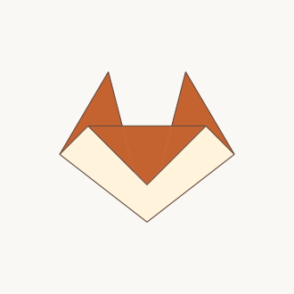

# 一枚の正方形からキツネの顔を設計する

正面を向いたキツネを、正方形一枚で作る。紙を対角線で二つ折りし、左右の角に耳を割り当てた。採用した4案目では、紙の中央が鼻先になる。耳の間で額を折り下げると、先の細い橙色の額を挟んで、紙の裏色が左右の頬に現れる。



[採用案の展開図（Oriedita用）](../assets/examples/fox-face/validated/ruff/candidate.cp)・[日本語の折り図（A4）](../assets/examples/fox-face/fold-guide.svg)

## 折り線を引く前に決めたこと

同じ紙寸法、同じ向きで比較する。鼻先から両耳の中点までの長さを1として、耳の間隔、中央のくぼみの深さ、輪郭の左右差を測る。耳の印の両側で輪郭が下がることも調べる。鼻先側と頬側で顔幅を測り、下へ行くほど細くなるかを確かめる。判定の数値はこの正面像に合わせた設計目標として[プロファイル](../assets/examples/fox-face/profile.json)に保存してある。

## 形を変えて比較する

スキルのディレクトリから実行する。まず[レシピ](../assets/examples/fox-face/recipe.json)から展開図、紙面上の部位座標、その案を再生成するためのプランを作る。

```sh
python3 scripts/fox_face.py --out-dir work/variants
python3 scripts/compare_faces.py assets/examples/fox-face/profile.json \
  work/variants/close-set work/variants/balanced work/variants/wide-set work/variants/ruff \
  --validate --back --out-dir work/comparison
python3 scripts/fox_fold_guide.py work/variants/ruff/plan.json --output work/fold-guide.svg
```

Orieditaのローカル制御対応JARを `ORIEDITA_JAR` または `--jar` で指定できる。比較ではCPと計算結果のハッシュを照合する。変更したプランは新しいディレクトリに生成する。

収録済みの4案はPythonだけでも比較を再現できる。次のコマンドは保存した折り畳み結果から図と測定値を生成する。

```sh
study=assets/examples/fox-face
python3 scripts/compare_faces.py "$study/profile.json" \
  "$study/validated/close-set" "$study/validated/balanced" \
  "$study/validated/wide-set" "$study/validated/ruff" --back --out-dir work/replay
```

先に `silhouettes.svg` を開き、図だけを見て何に見えるか、どの箇所がそう見せているかを記録する。次に `paper.svg` で、表に出ている紙の面と折り目を確認する。色は同じ二色の紙を想定し、計算された層の表裏に従って付けている。`comparison.json` で左からの順番と設計値の対応、形の評価、具体的に足りない条件を調べられる。判定条件に近い別種の顔もありうるため、採用時にはラベルを伏せたときの読み取りも記録する。

## 4案からどう選んだか

図は左上、右上、左下、右下の順。輪郭だけの図と、紙の表裏を反映した図をそれぞれ収録した。[輪郭の比較](../assets/examples/fox-face/silhouettes.svg)・[二色の紙での比較](../assets/examples/fox-face/paper.svg)

| 位置 | 案 | 折り上がりを見て分かったこと |
| --- | --- | --- |
| 左上 | `close-set` | 顔の高さに対する耳の間隔は0.252。目標の0.35に届かず、二つの耳が中央に寄った。 |
| 右上 | `balanced` | 輪郭の4条件を満たし、点数は4案中で最も高い。 |
| 左下 | `wide-set` | 両耳の間隔が広く、額の上辺が長く見える。輪郭の4条件を満たした。 |
| 右下 | `ruff` | 額のくぼみは顔の高さの36%。輪郭の4条件を満たし、頬と額の色の境が鼻先へ視線を導く。 |

4案目の二色の図を、題材名も他の案も見せずに別のモデルに提示した。第一印象は「正面を向いた折り紙のキツネ」で、候補として猫も挙がった。三角耳、橙色の額、淡い頬という読み取りが設計意図と一致したため、この案を採用した。これはモデル1件の観察で、実紙での折りやすさは未確認。[各案の測定値](../assets/examples/fox-face/comparison.json)・[独立した折り畳み計算の結果](../assets/examples/fox-face/independent-check.json)

## 次の試作につなげる

最初の3案では、`ear_root` は耳の折り線が長辺を通る位置、`ear_slope` はその傾き、`muzzle_depth` は鼻先から折り上げる量を決める。実際に1案目で `ear_root` だけを0.55から0.65に動かすと、再計算した耳の間隔は顔の高さの0.252から0.586に広がり、目標を満たした。

採用案は耳の折り線の傾き `ear_slope` と、三角形の高さに対する額の折り位置 `brow_height` の2か所を調整できる。例えば耳を広げたいときは、[採用案のプラン](../assets/examples/fox-face/validated/ruff/plan.json)を `work/next-plan.json` にコピーし、`ear_slope` だけを1.29から1.35に変えて比較する。

```sh
python3 scripts/fox_face.py --plan work/next-plan.json --out-dir work/revised
```

実際に折った写真や感想が届いたら、試した案のハッシュと部位に紐付け、同じ紙・視点で変更前後を比較する。[実紙の記録手順](paper-feedback.md)
